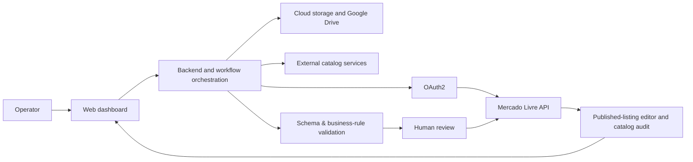

# MLBot — Mercado Livre Automation Dashboard

> Sanitized case study of a paid confidential freelance project. Client source code, credentials, business data, screenshots, and proprietary rules are intentionally omitted.

## Executive summary

MLBot is a production web dashboard built to automate the end-to-end creation, publication, editing, and auditing of Mercado Livre listings through the Mercado Livre REST API.

I independently designed and implemented the solution — from architecture, OAuth2 integration, and validation rules to automated tests and Docker packaging. The system processed **500+ listings** in production.

## The problem

Managing a large marketplace catalog manually created recurring bottlenecks:

- Repetitive listing creation and publication steps
- Inconsistent product attributes, pricing, and images across listings
- Slow batch updates on already-published items
- Low visibility into catalog-wide inconsistencies and failed payloads

## What I built

- Automated listing creation and publication via Mercado Livre API
- Centralized editor for reviewing and updating published listings
- Catalog-wide audit workflow to flag incomplete or inconsistent records
- OAuth2 authentication and token refresh lifecycle
- Cloud storage, Google Drive, and external catalog service integrations
- Strict payload validation, automated test suite, and Dockerized runtime
- Explicit human-review checkpoints before publishing changes to production

## Sanitized architecture

## Main workflows

### 1. Listing creation and publication
Product data enters the dashboard, passes through normalization and schema validation, and is transformed into the Mercado Livre API payload. Publication remains an explicit, reviewable action.

### 2. Published-listing editor
Retrieves live listings via API and applies controlled updates from a single interface, eliminating repetitive manual edits.

### 3. Catalog audit
Consolidates live listing records so incomplete attributes, missing media, and inconsistencies can be reviewed and fixed systematically.

### 4. Validation & reliability controls
Every outgoing API payload is checked before hitting Mercado Livre:
- Schema and business-rule validation before publishing
- Automated tests covering happy paths and failure handling
- Security checks and isolated credentials management
- Explicit human approval before mutating live listings

## Results

- **500+ listings** processed in production
- Creation, publication, editing, and auditing unified in one operational dashboard
- Manual, error-prone steps converted into repeatable, validated workflows

---

Versão em português

## Resumo executivo

O MLBot é um painel web em produção desenvolvido para automatizar a criação, publicação, edição e auditoria de anúncios via API REST do Mercado Livre.

Projetei e implementei a solução de ponta a ponta — da arquitetura, autenticação OAuth2 e regras de validação até testes automatizados e empacotamento com Docker. O sistema processou mais de **500 anúncios** em produção.

## Solução

- Automação de criação e publicação de anúncios via API do Mercado Livre
- Editor centralizado para atualizar anúncios já publicados
- Rotina de auditoria geral do catálogo para identificar inconsistências
- Fluxo OAuth2 com renovação de tokens e integrações com Google Drive, armazenamento em nuvem e serviços externos
- Validação rigorosa de payloads, testes automatizados, containers e revisão humana antes de publicar

## Resultados

- Mais de **500 anúncios** processados em produção
- Criação, edição e conferência unificadas em um único painel
- Redução de retrabalho manual com fluxos validados e auditáveis

## Contact

- [LinkedIn](https://www.linkedin.com/in/viniciusoccavalheiro/)
- [GitHub profile](https://github.com/ViniOcCode)
