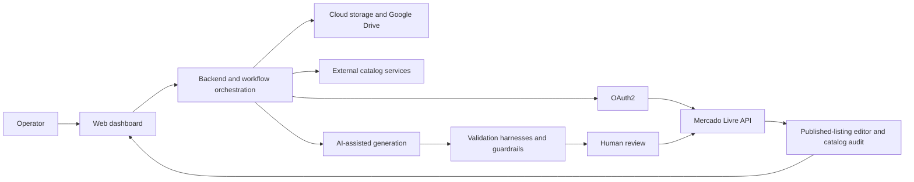

# MLBot — Mercado Livre Automation Dashboard

> Sanitized case study of a paid confidential freelance project. This repository contains no client source code, credentials, business data, screenshots, or proprietary implementation details.

## Executive summary

MLBot was a production web dashboard that automated the end-to-end creation and publication of Mercado Livre listings. It also provided a centralized editor for published listings and a general audit workflow through the Mercado Livre API.

I independently designed and implemented the solution, from architecture and integrations to testing, containers, and operational workflows. The system was used to process more than **500 listings**.

## The problem

Managing a large catalog manually created several operational costs:

- Repetitive listing creation and publication work
- Inconsistent product information and images
- Slow updates across already-published listings
- Limited visibility into catalog-wide inconsistencies
- Risk of publishing AI-generated output without adequate validation

The project needed a single operational dashboard that could automate routine work while keeping critical decisions reviewable.

## What I built

- Automated listing creation and publishing through the Mercado Livre API
- An editor for reviewing and updating published listings
- General catalog auditing and conference workflows
- OAuth2 authentication and token-based API integration
- Cloud storage, Google Drive, and Seller7 integrations
- AI-assisted image and listing generation
- Validation steps, automated tests, containers, and operational routines
- Human-review checkpoints before sensitive publishing actions

## Sanitized architecture

The diagram intentionally omits deployment topology, credentials, customer-specific rules, and proprietary data structures.

## Main workflows

### 1. Listing creation and publication

Product information entered the dashboard, passed through normalization and validation, and was transformed into the payload required by the Mercado Livre API. Publishing remained an explicit, reviewable action.

### 2. Published-listing editor

The dashboard retrieved existing listings and made controlled updates possible from one interface instead of requiring repetitive manual edits.

### 3. General catalog audit

The audit workflow consolidated listing information so inconsistencies and incomplete records could be reviewed across the catalog.

### 4. AI-assisted content generation

AI supported image and listing creation, but generated output was never treated as automatically correct. The workflow combined:

- Structured prompts and explicit context
- Reusable skills for repeatable tasks
- Task-specific validation harnesses
- Guardrails and business-rule checks
- Automated tests and security checks
- Human review before publication

## AI-assisted engineering approach

I also used AI as part of the software engineering workflow. Larger goals were decomposed into bounded tasks for agents, with reusable skills and harnesses supplying consistent instructions and verification criteria.

The operating principle was simple: **AI can accelerate implementation, but evidence must determine whether the result is accepted.** Generated work was reviewed through tests, code review, security checks, and direct validation against the requested behavior.

## Engineering responsibilities

- Requirements analysis and workflow modeling
- Backend and integration architecture
- Mercado Livre API and OAuth2 integration
- Data and operational workflow design
- AI-assisted generation with controlled validation
- Automated testing and failure-path verification
- Containerization and delivery support
- Maintenance workflows for more than 500 listings

## Results

- More than **500 listings** processed through the system
- Creation, publication, editing, and auditing centralized in one dashboard
- Repetitive operational steps converted into reviewable automated workflows
- AI generation placed behind validation and human-review controls
- A maintainable operational foundation for catalog-wide changes

## What this case study demonstrates

- Backend development and API integration
- OAuth2 and external-service orchestration
- Automation of real commercial workflows
- Practical AI governance through harnesses, guardrails, tests, and review
- End-to-end ownership of a production-oriented freelance project

## Confidentiality

This case study describes the project at a portfolio-safe level. Client identity, source code, credentials, datasets, commercial rules, internal screenshots, and infrastructure details are intentionally excluded.

---

Versão em português

## Resumo executivo

O MLBot foi um painel web de produção que automatizava todo o fluxo de criação e publicação de anúncios no Mercado Livre. O sistema também oferecia um editor centralizado para anúncios publicados e uma rotina de conferência geral por meio da API do Mercado Livre.

Projetei e implementei a solução de forma independente, da arquitetura e integrações aos testes, containers e fluxos operacionais. O sistema foi utilizado no processamento de mais de **500 anúncios**.

## Problema

A gestão manual de um catálogo grande gerava trabalho repetitivo, inconsistências em informações e imagens, lentidão nas atualizações e pouca visibilidade sobre problemas gerais do catálogo. Também existia o risco de publicar conteúdo gerado por IA sem validação suficiente.

## Solução

- Automação da criação e publicação de anúncios pela API do Mercado Livre
- Editor para revisar e atualizar anúncios já publicados
- Rotinas de conferência geral do catálogo
- Autenticação OAuth2 e integrações com armazenamento em nuvem, Google Drive e Seller7
- Geração assistida por IA para imagens e anúncios
- Testes, containers, validações e rotinas operacionais
- Pontos de revisão humana antes de ações sensíveis de publicação

## Uso controlado de IA

A IA apoiava a geração de imagens e anúncios, mas suas saídas não eram consideradas corretas automaticamente. O fluxo utilizava prompts e contexto estruturados, skills reutilizáveis, harnesses de validação, guardrails, testes automatizados, checagens de segurança e revisão humana.

Também apliquei IA no processo de engenharia de software, decompondo objetivos maiores em tarefas limitadas para agentes e utilizando evidências — testes, revisão de código e validação do comportamento — para aceitar ou rejeitar os resultados.

## Resultados

- Mais de **500 anúncios** processados pelo sistema
- Criação, publicação, edição e conferência reunidas em um único painel
- Etapas repetitivas convertidas em fluxos automatizados e revisáveis
- Geração por IA protegida por validações e revisão humana
- Base operacional sustentável para alterações em todo o catálogo

## Confidencialidade

Este estudo de caso apresenta somente informações seguras para portfólio. Identidade do cliente, código-fonte, credenciais, dados, regras comerciais, imagens internas e detalhes de infraestrutura foram intencionalmente omitidos.

## Contact

- [LinkedIn](https://www.linkedin.com/in/viniciusoccavalheiro/)
- [GitHub profile](https://github.com/ViniOcCode)
